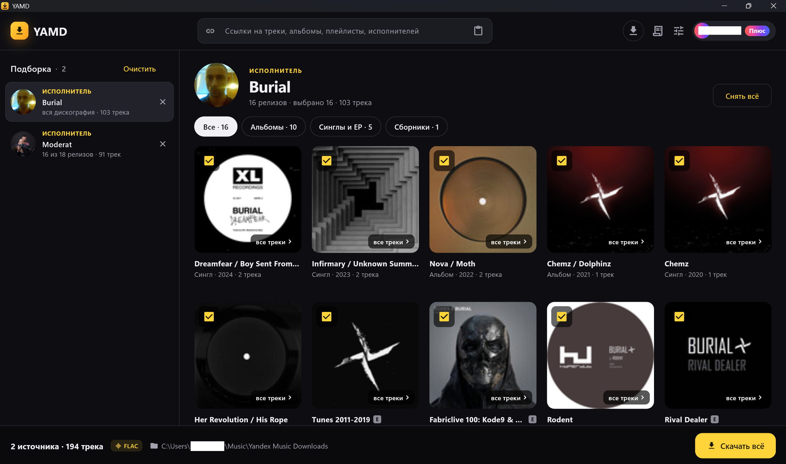

# YAMD · Yet Another Music Downloader

  
     

**Ваша музыка из Яндекс Музыки в студийном качестве. На компьютере и на
телефоне.**

Найдите любимый альбом прямо в приложении, нажмите «Скачать», и он уже у вас:
с обложкой, названиями и аккуратно разложенный по папкам. Треки, альбомы,
плейлисты и целые дискографии в **FLAC без потерь** до 24 бит / 192 кГц или
в MP3 320.

> Для подписчиков **Яндекс Плюс**.

## Почему YAMD

**Поиск прямо в приложении.** Начните вводить название песни, альбома или имя
исполнителя, и результаты появятся сразу. Опечатки не страшны: YAMD подскажет,
что вы имели в виду.

**Или просто вставьте ссылку.** Трек, альбом, плейлист, исполнитель, хоть
десяток ссылок разом. Каждая превратится в карточку с обложкой, а скачать всё
можно одной кнопкой.

**Только то, что нужно.** Отметьте галочками нужные треки в альбоме или нужные
альбомы у исполнителя.

**Звук как в студии.** Настоящий lossless, а не пережатая копия. Если у трека
нет версии без потерь, YAMD возьмёт лучшее из доступного.

**Красивая медиатека без усилий.** Обложки, названия, номера треков и год
появляются в файлах сами, а альбомы раскладываются по папкам. Любой плеер
сразу покажет всё как надо.

**Быстро и в фоне.** Несколько треков качаются одновременно. Можно свернуть
приложение и заниматься своими делами: на телефоне прогресс виден в
уведомлении, а на компьютере загрузки продолжаются, даже когда окно свёрнуто.

**Ничего не теряется.** Пропал интернет? YAMD сам попробует снова. Уже
скачанное повторно не качается.

**Приятно пользоваться.** Современный интерфейс, тёмная и светлая темы.

**Всегда свежая версия.** YAMD сам замечает обновления и ставит их в пару
нажатий.

## Вход за минуту

Нажмите «Войти через Яндекс», откройте [ya.ru/device](https://ya.ru/device) на
любом устройстве и введите код из приложения. Всё, пароль никуда вводить не
нужно, а заходить заново не придётся.

## Ваши данные остаются вашими

Доступ к аккаунту хранится только на вашем устройстве и нигде больше. YAMD
общается напрямую с Яндексом, без посредников и сбора статистики. При выходе
из аккаунта доступ закрывается и на стороне Яндекса. Код программы открыт:
каждый может проверить, что она делает.

## Скачать

Свежая версия всегда на странице [релизов](../../releases):

| Где | Что скачать |
|---|---|
| Android | `YAMD-android-arm64.apk` |
| Windows | `YAMD-windows.zip` |
| macOS | `YAMD-macos.dmg` |
| Linux | `YAMD-linux-x86_64.AppImage` |

На Android откройте файл и разрешите установку. Для старых 32-битных телефонов
есть `YAMD-android-arm.apk`.

На macOS при первом запуске система может заблокировать приложение. Откройте
«Системные настройки», раздел «Конфиденциальность и безопасность», и нажмите
«Всё равно открыть».

## Важно

YAMD неофициальный проект и не связан с компанией «Яндекс». «Яндекс», «Яндекс
Музыка» и «Яндекс Плюс» являются товарными знаками их правообладателей.

Программа предназначена только для личного использования музыки, к которой у
вас есть доступ по подписке. Не распространяйте скачанные файлы: это может
нарушать авторские права. За использование программы и скачанных материалов
отвечаете вы сами.

YAMD предоставляется «как есть», без гарантий. Если Яндекс что-то изменит у
себя, часть функций может временно перестать работать.
